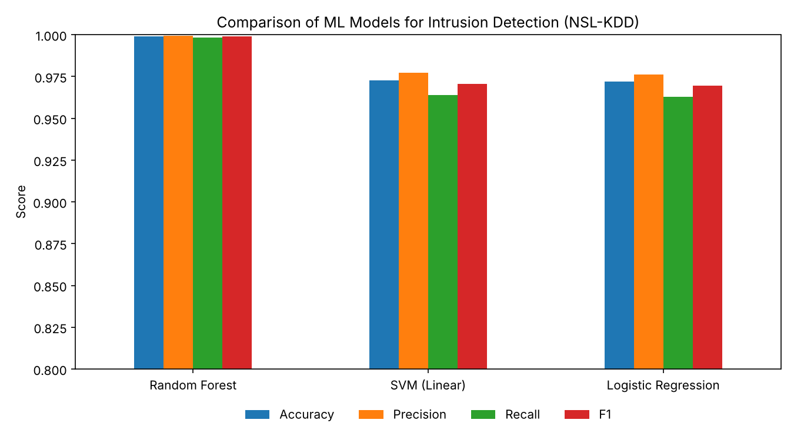
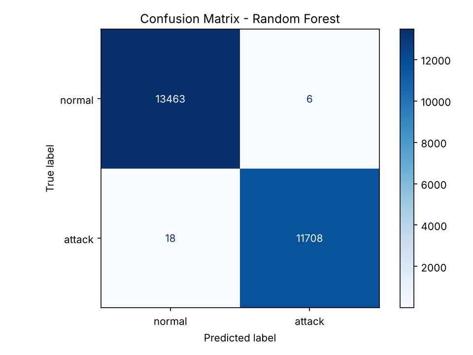
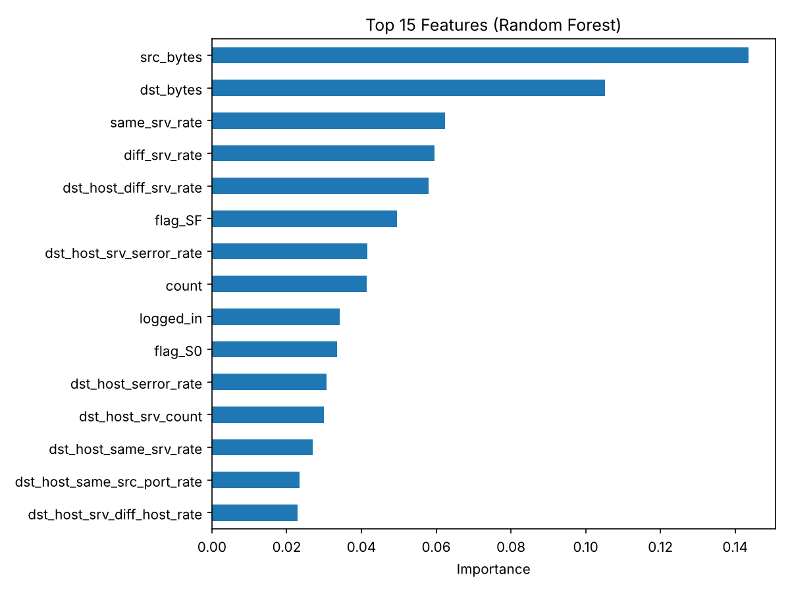

# Intrusion Detection System Using Machine Learning

A machine learning–based Intrusion Detection System (IDS) that classifies network connections as **normal** or **malicious** using the **NSL-KDD** dataset. It compares three classifiers (Random Forest, Linear SVM and Logistic Regression) and reports how well each one detects the four major attack categories.

Group project for **CSE 3968**, ITER, Siksha 'O' Anusandhan University.

## Results

80/20 stratified split of `KDDTrain+.txt` (125,973 connections, 41 features):

| Model | Accuracy | Precision | Recall | F1 |
|---|---|---|---|---|
| **Random Forest** | **99.90%** | **99.95%** | **99.85%** | **99.90%** |
| SVM (Linear) | 97.27% | 97.73% | 96.38% | 97.05% |
| Logistic Regression | 97.19% | 97.62% | 96.30% | 96.96% |

**Detection rate by attack category** (share of attacks correctly flagged):

| Category | Random Forest | SVM (Linear) | Logistic Regression |
|---|---|---|---|
| DoS (Denial of Service) | 99.99% | 98.15% | 98.18% |
| Probe (scanning) | 99.71% | 96.02% | 95.14% |
| R2L (Remote to Local) | 95.58% | 29.20% | 33.63% |
| U2R (User to Root)* | 100% | 66.67% | 66.67% |

\*U2R has only 52 records in the whole dataset, so its test-set figures are based on very few samples.

**Key finding:** all three models detect high-volume attacks (DoS, Probe) well, but the linear models miss most R2L attacks. These are rare, low-volume attacks that look similar to normal traffic. Random Forest captures the non-linear patterns and detects over 95% of them.



| Confusion matrix (Random Forest) | Top features |
|---|---|
|  |  |

## Approach

1. **Load** NSL-KDD with proper column names (the raw file has no header row).
2. **Clean** by removing duplicates and constant columns, and map every attack name to its category (DoS, Probe, R2L, U2R).
3. **Target** is binary: `normal` vs `attack`. The dataset's `difficulty` column is metadata, so it is excluded from the features.
4. **Split** into an 80/20 stratified train/test split *before* any scaling, to avoid data leakage.
5. **Preprocess** inside a scikit-learn `Pipeline`: one-hot encoding for `protocol_type`, `service` and `flag`, and standard scaling for the numeric features.
6. **Train and evaluate** the three models on accuracy, precision, recall, F1, confusion matrix and per-category detection rate.

## How to run

```bash
pip install -r requirements.txt
python IDS.py
```

It runs in under 15 seconds on a laptop. Metrics are printed to the console and the CSV results and plots are saved to `results/`.

## Project structure

```
├── IDS.py              # full pipeline: load → preprocess → train → evaluate → plot
├── KDDTrain+.txt       # NSL-KDD training set
├── requirements.txt
└── results/            # generated metrics (CSV) and plots (PNG)
```

## Limitations and future work

- Evaluation uses a split of `KDDTrain+`. The official `KDDTest+` set contains attack types that are not in the training data, so testing on it would measure how well the models generalise to new attacks.
- Rare classes (R2L, U2R) could be improved with class weighting or oversampling (SMOTE).
- Multi-class classification (predicting the attack category directly) and gradient-boosted models (XGBoost, LightGBM) could also be tried.

## Author

Sampreeti Mohapatra

## Dataset

NSL-KDD, Canadian Institute for Cybersecurity, University of New Brunswick: https://www.unb.ca/cic/datasets/nsl.html
